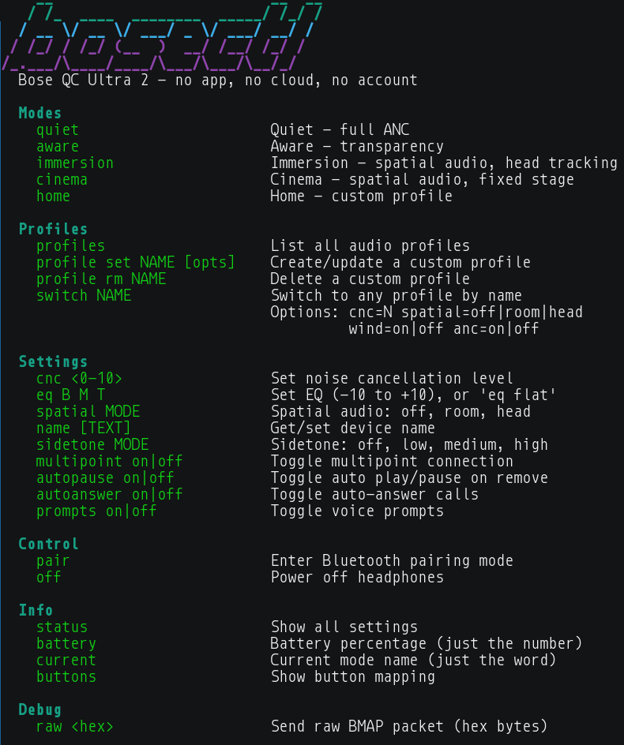

# bosectl

[](LICENSE)
[](https://github.com/aaronsb/bosectl/releases/latest)
[](docs/architecture.md#device-catalog)
[](python/)
[](rust/)
[](cpp/)
[](#)

**Control Bose headphones from Linux and macOS — no app, no cloud, no account.**



Python, Rust, and C++ libraries implementing Bose BMAP over Bluetooth RFCOMM for noise cancellation, EQ, spatial audio, button mapping, and profiles.

**Desktop app:** [bosectl-qt](https://github.com/aaronsb/bosectl-qt) is a Qt6 system tray app built on the C++ library (in the AUR as `bosectl-qt`).

> **This is not an exploit.** BMAP's standard SETGET and START operators work without authentication; no keys are extracted or encryption broken.

## Supported Devices

| Device                      | NC Control                            | EQ     | Spatial        | Profiles              | Buttons                | Status             |
| --------------------------- | ------------------------------------- | ------ | -------------- | --------------------- | ---------------------- | ------------------ |
| **QC Ultra Headphones 2**   | CNC 0-10 slider                       | 3-band | room/head      | 7 custom slots        | Shortcut remap         | Verified           |
| **QC Ultra Earbuds 2**      | CNC 0-10 (verified)                   | inherited | modes verified | inherited           | inherited              | Battery/status/modes/CNC verified (`edith`) |
| **QuietComfort Headphones** | CNC 0-10 + Wind Block via ModeConfig  | 3-band | field observed | 2 user slots observed | —                      | Verified (`prince`) |
| **QuietComfort 35 / 35 II** | ANR off/high/wind/low                 | —      | —              | —                     | Action remap (VPA/ANC) | Verified           |
| **QuietComfort Earbuds**    | CNC 0-10 via direct SETGET            | 3-band | —              | 4 fixed modes         | Remap                  | Verified (`lando`) |
| **QuietComfort 45**         | CNC 0-10 via ModeConfig               | 3-band | —              | 2 user slots          | Remap                  | Verified (`duran`) |
| **Ultra Open Earbuds**      | — (open-ear)                          | 3-band | —              | switch only           | —                      | Partial (`serena`), from device report |
| **Noise Cancelling Headphones 700** | CNC 0-10 via direct SETGET    | read   | —              | —                     | —                      | Verified (`goodyear`) |

### Device Roadmap

The [device catalog](docs/architecture.md#device-catalog) lists all known BMAP-capable Bose products by Bluetooth product ID. See [Adding a New Device](docs/architecture.md#adding-a-new-device):

| Device                          | Codename  | Category   | PID      |
| ------------------------------- | --------- | ---------- | -------- |
| QuietComfort Ultra Headphones   | lonestarr | Headphones | `0x4066` |
| QuietComfort Earbuds II         | smalls    | Earbuds    | `0x4064` |
| QuietComfort Ultra Earbuds      | scotty    | Earbuds    | `0x4072` |
| SoundLink Flex                  | phelps    | Speaker    | `0xBC59` |
| SoundLink Flex 2                | mathers   | Speaker    | `0xBC61` |

## Quick Start

### Library Usage

```python
import pybmap

with pybmap.connect() as dev:
    print(dev.battery())            # 80
    print(dev.name())               # "Obsidian Countess"
    dev.set_anr("high")             # QC35: full noise cancellation
    dev.set_cnc(8)                  # CNC level 0-10 (0=max ANC)
    dev.set_eq(3, 0, -2)            # Bass +3, mid flat, treble -2
    dev.set_buttons(0x10, 4, 2)     # Remap Action button to ANC
```

```rust
use bmap::connect;

let dev = connect(None, None)?;
println!("{}%", dev.battery()?);    // 80
dev.set_anr("high")?;              // QC35
dev.set_cnc(8)?;                   // CNC level 0-10 (0=max ANC)
```

```cpp
#include "bmap.h"

auto dev = bmap::connect();
std::cout << (int)dev->battery() << "%\n";
dev->set_anr("high");              // QC35
dev->set_cnc(8);                   // CNC level 0-10 (0=max ANC)
```

### CLI Usage

```bash
bosectl status              # Show model, battery, mode, settings
bosectl cnc 7               # Noise cancellation level (0=max ANC)
bosectl anr high            # Noise cancellation mode (QC35)
bosectl eq 3 0 -2           # EQ: bass/mid/treble
bosectl buttons set ANC     # Remap programmable button
bosectl quiet               # Switch to Quiet mode
```

When `BMAP_MAC` (or `BOSE_MAC`) is set, also set `BMAP_DEVICE` to the matching config key.

### Device Catalog API

```python
import pybmap

dev = pybmap.lookup_device(0x4082)
print(dev.name, dev.codename)       # "QuietComfort Ultra Headphones (2nd Gen)" "wolverine"
pybmap.usb_ids(0x4082)              # (0x05A7, 0x4082)
pybmap.modalias(0x4082)             # "bluetooth:v05A7p4082d0000"
pybmap.is_supported(0x4082)         # True
pybmap.supported_devices()          # [wolfcastle, baywolf, duran, prince, wolverine, lando, edith, serena]
pybmap.known_devices()              # full catalog
```

## Installation

### Prerequisites

- **Linux:** BlueZ stack and headphones paired via `bluetoothctl`
- **macOS:** macOS 10.15+ and headphones paired via System Settings

### With Homebrew (macOS)

Installs both the Python CLI (`bosectl`) and the Rust crate binary (`bmapctl`), shell completions, and a `brew services` definition directly from this repository:

```bash
brew tap aaronsb/bosectl https://github.com/aaronsb/bosectl.git
brew install aaronsb/bosectl/bosectl
brew services start bosectl   # optional periodic status polling service
```

### With Installer Script or pipx

```bash
git clone https://github.com/aaronsb/bosectl.git
cd bosectl
./linux_install.sh            # or ./macOS_install.sh
# Or isolate in a virtualenv via pipx:
pipx install ./python
```

### From Release Binaries (Linux)

```bash
curl -LO https://github.com/aaronsb/bosectl/releases/latest/download/bmapctl-rust-linux-x86_64
curl -LO https://github.com/aaronsb/bosectl/releases/latest/download/SHA256SUMS
sha256sum -c SHA256SUMS
install -m 755 bmapctl-rust-linux-x86_64 /usr/local/bin/bmapctl
```

### From crates.io (Rust, Linux)

```bash
cargo install bose-bmap   # installs the bmapctl binary
cargo add bose-bmap       # use as a library; the import is still `use bmap::`
```

### From Source

The C++ build and `make test` need BlueZ headers (`libbluetooth-dev` on Debian/Ubuntu, `bluez-libs-devel` on Fedora, `bluez-libs` on Arch), CMake, and Rust:

```bash
git clone https://github.com/aaronsb/bosectl.git
cd bosectl
make test          # Run all tests (Python + Rust + C++)
make artifacts     # Build release binaries + SHA256SUMS
```

### Pairing (Linux)

```bash
bluetoothctl
> scan on
> pair XX:XX:XX:XX:XX:XX
> trust XX:XX:XX:XX:XX:XX
> connect XX:XX:XX:XX:XX:XX
> exit
```

`bosectl` auto-detects paired Bose devices by their BMAP service UUID.

## Architecture

```
Application → BmapConnection → Device Config → Transport → Protocol → Bluetooth RFCOMM
```

- **Protocol** — binary BMAP packet codec
- **Transport** — RFCOMM socket with drain mode for async responses
- **Device Config** — data-only description of each headphone model (addresses, parsers, quirks)
- **BmapConnection** — typed API that dispatches to the right address/parser per device
- **Catalog** — all known Bose BMAP devices with product IDs, codenames, and USB identifiers

Full documentation: **[docs/architecture.md](docs/architecture.md)**, **[NOTES.md](NOTES.md)**, **[QuietComfort Headphones notes](docs/quietcomfort-headphones-prince.md)**, and **[QuietComfort 45 notes](docs/quietcomfort-45-duran.md)**.

## Project Structure

```
├── Formula/bosectl.rb   # Homebrew formula (bosectl + bmapctl + service)
├── python/pybmap/       # Python library + bosectl CLI
├── rust/src/            # Rust library (bose-bmap crate) + bmapctl CLI
├── cpp/src/             # C++ library + bmapctl CLI
├── completion/          # Zsh and Bash tab completions
├── docs/                # Architecture guide, device docs
├── NOTES.md             # Protocol reverse engineering notes
├── Makefile             # Build, test, release across all languages
└── fixtures/            # Captured protocol data
```

## Building & Releasing

```bash
make test                       # All tests (Python, Rust, C++)
make artifacts                  # Build + strip + SHA256SUMS in dist/
make release VERSION=vX.Y.Z     # Test → build → tag main and create the GitHub release
make clean                      # Remove all build artifacts
```

## Contributing

Fixes, new devices and hardware reports are welcome. [CONTRIBUTING.md](CONTRIBUTING.md) says what a pull request needs to show, and pull requests target the `integration` branch. Agents working on the code also read [AGENTS.md](AGENTS.md).

## License

MIT
